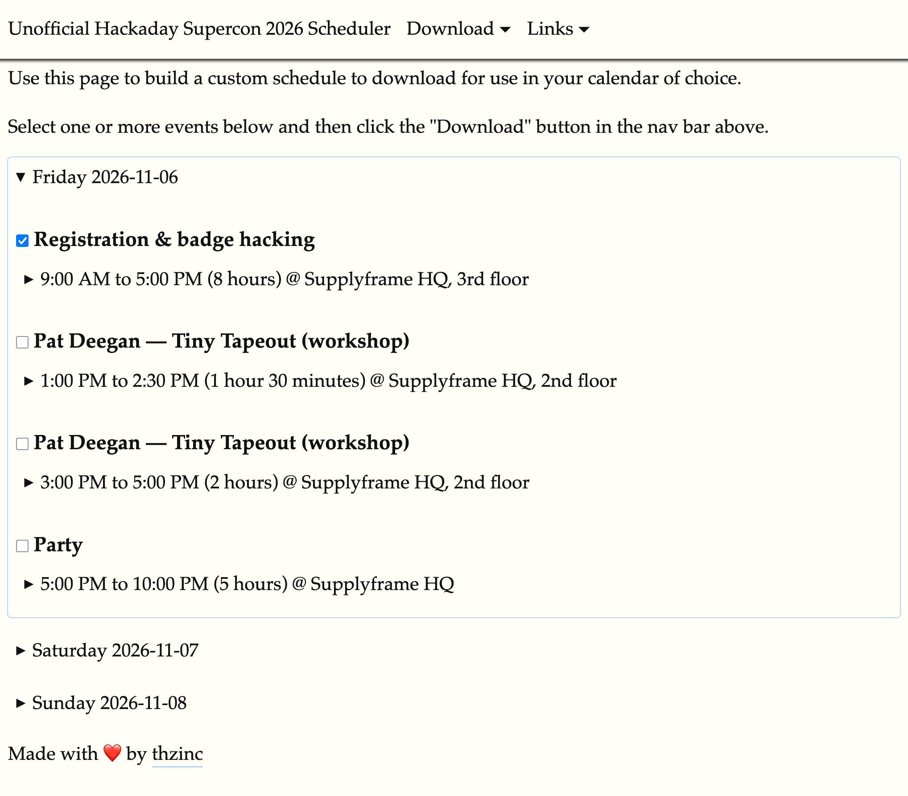

It seems like a lot of schedules for conferences I've attended advertise their schedules in a visually-appealing way, but don't offer any integration with the tools I rely on for scheduling anything else. I don't enjoy having to navigate a table with multiple conference tracks and multiple days' worth of sessions to figure out where I want to go next. I just want it on my calendar where I schedule everything else.

I am excited about the lineup of speakers at [this year's Supercon][supercon] and decided to solve my own problem with a quick web app: [supercon.thzinc.dev][supercon-scheduler].

The web app pulls the latest schedule information from the two JavaScript assets loaded on its page, then assembles them into a list of checkboxes to pick and choose a customized schedule. Then you can download an `.ics` file (VCalendar format, used by most calendar software) and move on with life.

[supercon]: https://hackaday.io/superconference/
[supercon-scheduler]: https://supercon.thzinc.dev/
