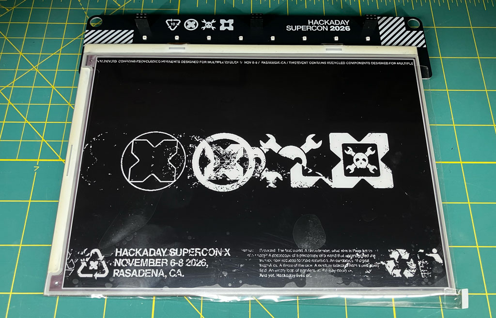
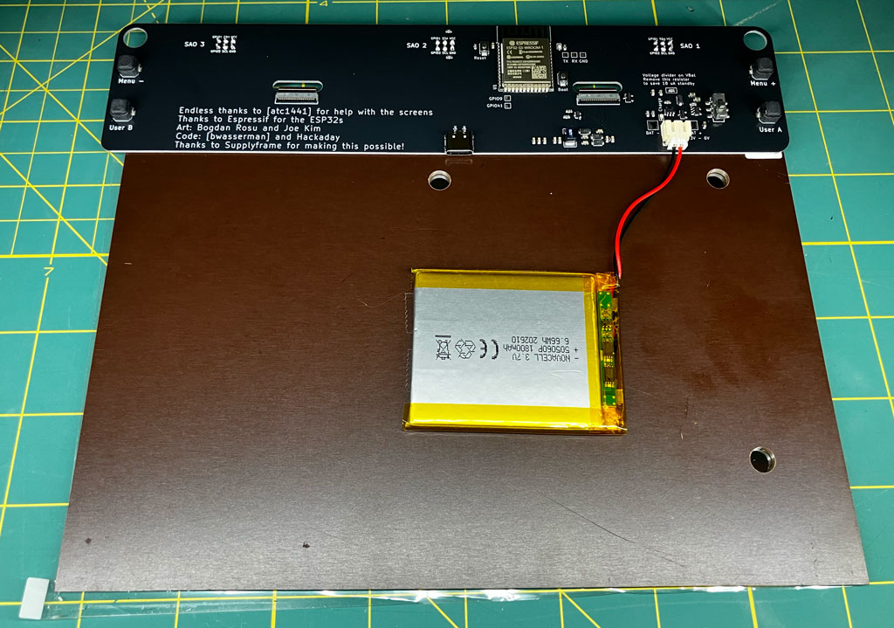
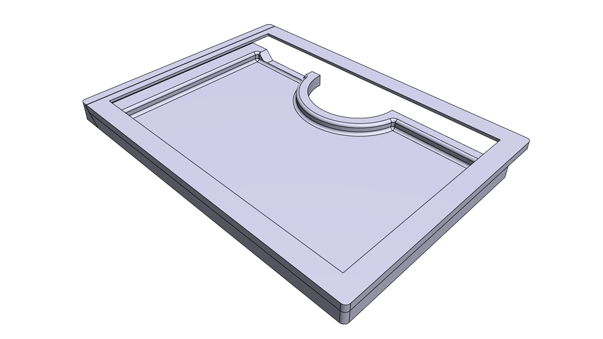
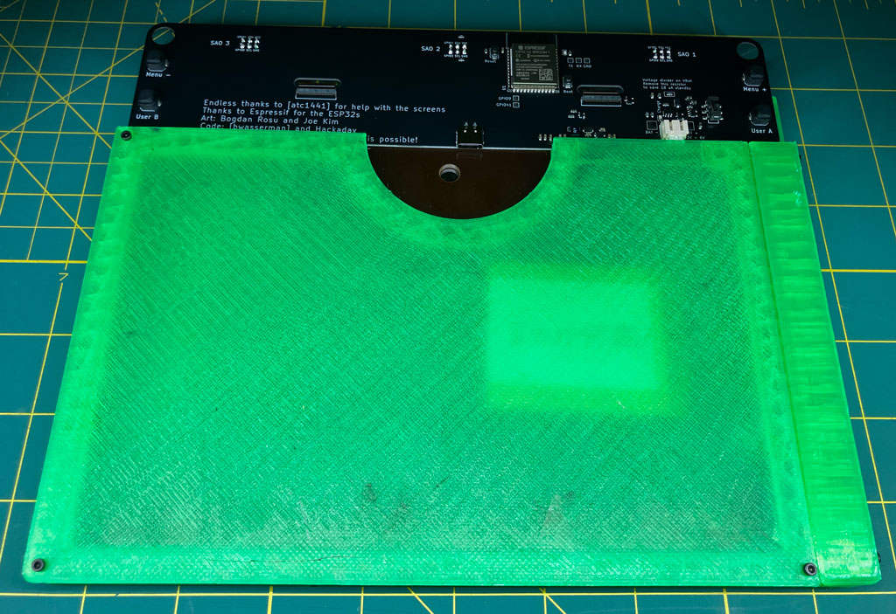
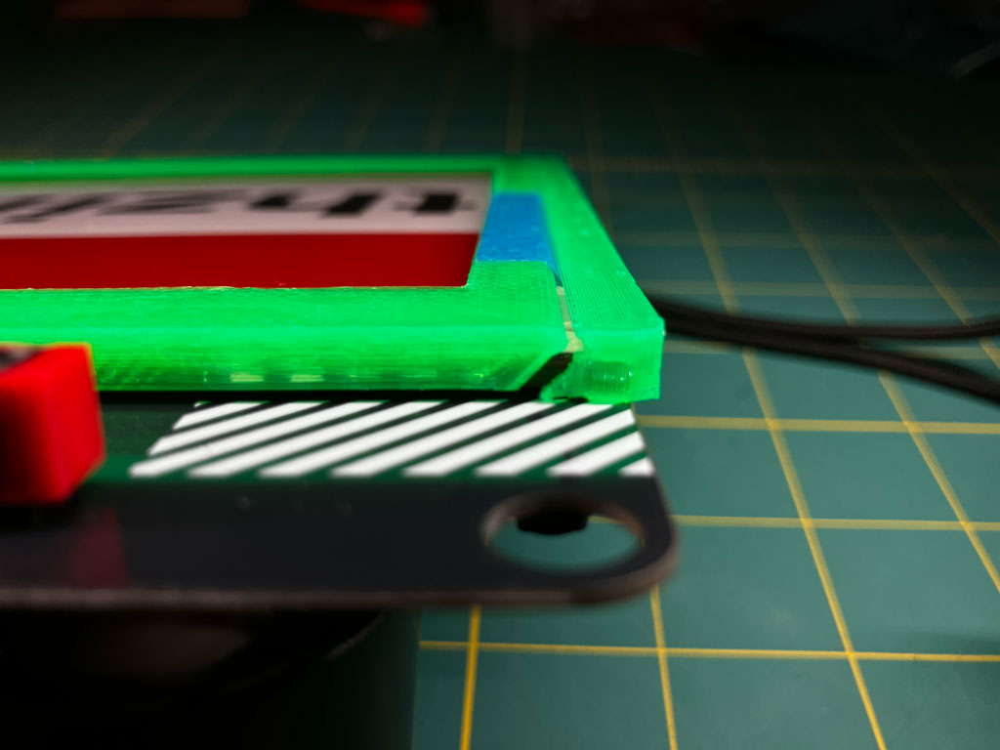
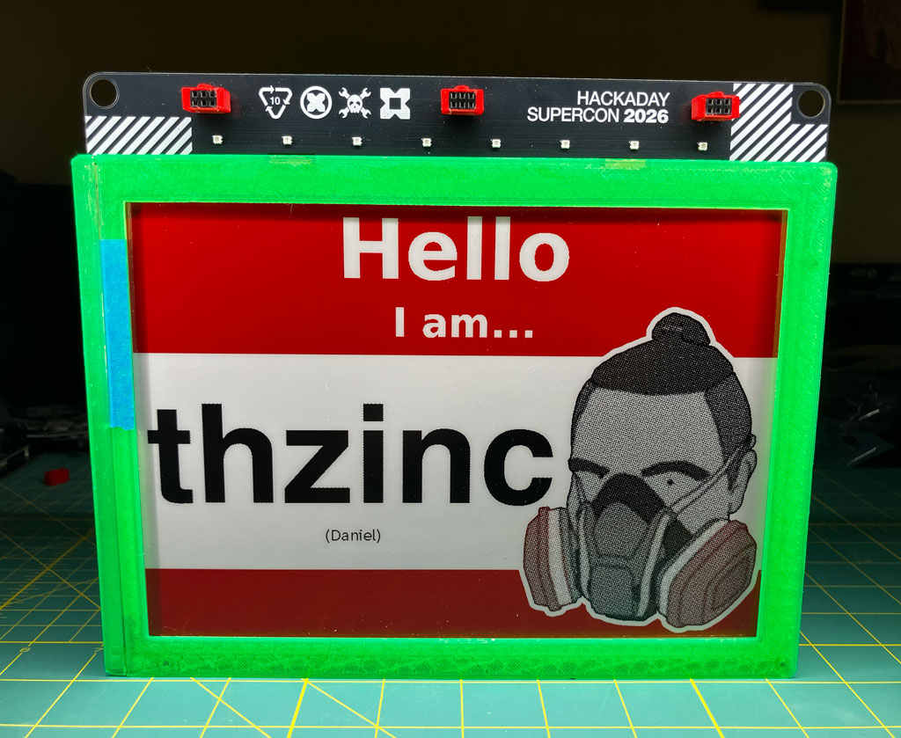

We didn't get a preview of the [Supercon] badge before attendees were handed a 10-inch tablet called the Billboard Badge. As the story went, the main unique feature of the badge was a reclaimed e-ink display from a defunct German retailer's price tag system. The displays are _nominally_ black, white, and red with a respectable 960x672 resolution.

The back of the badge revealed quite a simple layout: four buttons, an ESP-32, USB-C port, and a LiPo battery pack taped to the back of the e-ink panel. I didn't feel terribly comfortable having the LiPo battery snagging on my shirt, bouncing around, and generally clinging to the badge unprotected.

The hardware info—along with [a 3D model of the included front bezel][github-bezel]—were pushed to GitHub on the first day, so I used that as the basis for a case design that included a solid back cover.

The e-ink panel is mounted to center the image on the badge, but the carrier board is offset to accommodate headers around the left and top of the board, so there was not sufficient space to place a fourth fastener to secure the bezel to the back case. I decided to split the case into three parts: bezel, back cover, and left end cap.

{:.invertible}

Printing the back cover took about 6 hours, which I started on the evening of day 1. In the morning of day 2, I started printing the bezel and end cap before I left for the conference. I came home to a finished print that fit surprisingly well for having designed it with only a few measurements and no intermediate fit tests.

The design was not perfect, however. I overestimated how snugly I could make the end cap fit, and it did not adequately retain the top-left corner of the bezel. I ended up using some blue painter's tape to keep it from rattling. However, even this did not affect the protective fit of the case, which was still secured by the rest of the design.

I wore the badge to day 3 and felt significantly more comfortable knowing that the battery was behind ~1.2mm of rigid PLA. As a bonus, the design included a flat bottom intended to allow the badge to stand on its own!

[supercon]: https://hackaday.io/superconference/
[github-bezel]: https://github.com/Hack-a-Day/2026-Billboard_Badge/blob/main/hardware/billboard_mockup-Frame.step
